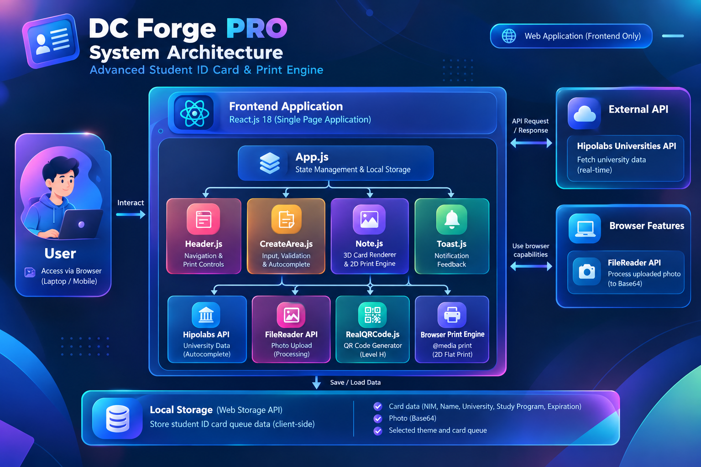
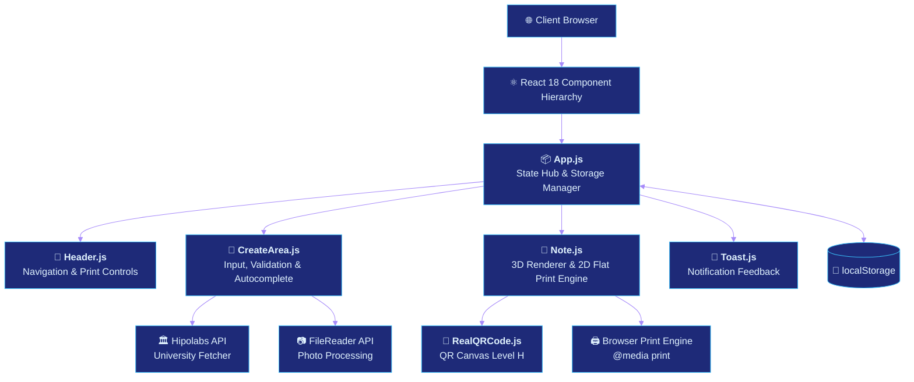

<!-- ═══════════════ HEADER ═══════════════ -->
<div align="center">



<br/><br/>

<p>
  Aplikasi web pembuat dan pencetak <b>Kartu Tanda Mahasiswa (KTM) / ID Card</b> berstandar <b>CR80 ISO (85.6 mm × 54 mm)</b><br/>
  dengan <b>3D Card Preview</b> interaktif dan hasil cetak <b>2D Flat Print</b> yang presisi.
</p>

<p>
  <a href="https://mesin-pencetak-kartu.vercel.app"></a>
  
  
  
</p>

<p>
  <a href="#-tujuan--manfaat">Tujuan</a> •
  <a href="#-fitur-unggulan">Fitur</a> •
  <a href="#️-arsitektur-sistem">Arsitektur</a> •
  <a href="#️-teknologi">Teknologi</a> •
  <a href="#️-antarmuka-pengguna">Antarmuka</a> •
  <a href="#-instalasi--menjalankan">Instalasi</a> •
  <a href="#-author">Author</a>
</p>

</div>

<br/>

<!-- ═══════════════ PREVIEW ═══════════════ -->
<div align="center">
  
  <br/>
  <sub><i>Tampilan aplikasi DC Forge PRO</i></sub>
</div>

---

## 🎯 Tujuan & Manfaat

**DC Forge PRO** dirancang sebagai aplikasi pembuat dan pencetak KTM modern berskala industri. Aplikasi ini memadukan pengalaman interaktif di layar (*3D Card Preview*) dengan akurasi hasil cetak fisik yang presisi tanpa distorsi.

| | Manfaat | Penjelasan |
|:-:|---|---|
| ⚡ | **Efisiensi & Kecepatan** | Membuat dan mengelola antrean banyak kartu sekaligus tanpa software desain berat seperti Photoshop atau CorelDraw |
| 🖨️ | **Hasil Cetak Presisi Tinggi** | Sistem *2D Flat Print Separation* menghilangkan bug visual (teks terbalik atau tumpang tindih saat cetak bolak-balik) |
| 🔐 | **Verifikasi Cepat** | QR Code dengan koreksi kesalahan **Level H** yang mudah dipindai kamera smartphone |
| ✅ | **Validasi Data Otomatis** | Mengurangi salah ketik pada nama, NIM, masa berlaku, dan nama perguruan tinggi |

---

## ✨ Fitur Unggulan

| | Fitur | Deskripsi |
|:-:|---|---|
| 🧠 | **Form Input Cerdas** | NIM hanya angka, cek duplikasi real-time, Title Case otomatis, dan autocomplete |
| 🏛️ | **Autocomplete Universitas** | Terhubung ke Hipolabs Universities API, dengan daftar cadangan saat offline |
| 🎓 | **Autocomplete Program Studi** | Rekomendasi jurusan umum, tetap bisa mengisi manual |
| 📅 | **Smart Expiration Picker** | Hanya bulan dan tahun mendatang, dengan preset +1, +2, +3, +4 tahun |
| 📷 | **Upload Foto & Avatar** | Unggah pasfoto lewat FileReader (Base64) atau pilih avatar ilustrasi |
| 🃏 | **3D Interactive Card Flip** | Putar kartu depan dan belakang dengan chip EMV emas, hologram, magnetic stripe, dan barcode |
| 🎨 | **5 Tema Kartu** | Black Gold, Sapphire Blue, Emerald Green, Cyber Purple, Minimalist White |
| 🔳 | **QR Code Presisi Tinggi** | Rasio 1:1, hitam-putih pekat, *quiet zone* aman, dan modal perbesar untuk uji pindai |
| 🖨️ | **Print Engine A4** | Render 2D datar lewat `@media print` dengan garis potong CR80 |
| 🔔 | **Toast Notification** | Umpan balik Success, Warning, Error, dan Info untuk setiap aksi penting |
| 💾 | **Penyimpanan Lokal** | Antrean kartu tersimpan di `localStorage`, tidak hilang saat refresh |

---

## 🏗️ Arsitektur Sistem

Aplikasi berupa **Single Page Application (SPA)** berbasis React 18 tanpa backend. State dan penyimpanan dikelola di `App.js`, lalu disalurkan ke komponen turunan.

<div align="center">
  
</div>

<br/>

### Hierarki Komponen



### Peran Komponen

| Komponen | Peran |
|---|---|
| `App.js` | Pusat state dan pengelola `localStorage` |
| `Header.js` | Navigasi, penghitung kartu aktif, selektor mode cetak, tombol contoh data dan cetak massal |
| `CreateArea.js` | Form input, validasi, dan autocomplete |
| `Note.js` | Penampil kartu 3D dan mesin cetak 2D datar |
| `Toast.js` | Notifikasi mengambang |
| `RealQRCode.js` | Pembuat QR Code Level H |

---

## 🛠️ Teknologi

<div align="center">


</div>

<br/>

| Komponen | Teknologi | Peran |
|---|---|---|
| **Frontend Framework** | React.js 18 | SPA modular dan reaktif |
| **Bahasa** | JavaScript (ES6+) & HTML5 | Logika data, manipulasi string (Title Case), dan markup semantik |
| **Styling** | Vanilla CSS3 | CSS Variables, Glassmorphism, 3D Transforms, Flexbox, Grid, dan `@media print` |
| **Ikon** | Lucide React | Printer, CreditCard, QrCode, Sparkles, Trash2, dan lainnya |
| **QR Code** | `qrcode` (npm) | Matriks QR 1:1, Error Correction Level H, dengan *quiet zone* |
| **Penyimpanan** | Web Storage API (`localStorage`) | Menyimpan antrean kartu di sisi klien |
| **API Eksternal** | Hipolabs Universities API | Pencarian universitas secara real-time |
| **Build & Tooling** | React Scripts (Webpack & Babel) | Bundle produksi yang teroptimasi |

---

## 🖥️ Antarmuka Pengguna

Sistem terbagi ke dalam 4 area kerja utama:

```text
+-------------------------------------------------------------------------------+
|  [DC Forge PRO]               [3 Kartu Siap] [Mode Cetak v] [Contoh] [Cetak]  | <- Header
+-------------------------------------------------------------------------------+
|                      |                                                        |
|   FORM INPUT         |   GALERI PREVIEW KARTU MAHASISWA                       |
|   - Foto Mahasiswa   |   [Filter Tema] [Pencarian Kartu]                      |
|   - NIM (Numerik)    |   +-------------------+  +-------------------+         |
|   - Nama (TitleCase) |   | [3D Flip Card #1] |  | [3D Flip Card #2] |         |
|   - Universitas      |   | Front / Back      |  | Front / Back      |         |
|   - Program Studi    |   | [Putar] [Cetak]   |  | [Putar] [Cetak]   |         |
|   - Masa Berlaku     |   +-------------------+  +-------------------+         |
|   - Pilihan Tema     |                                                        |
|   [+ Buat Kartu]     |                                                        |
|                      |                                                        |
+-------------------------------------------------------------------------------+
|  Panduan Kertas & Cetak | © 2026 DC Forge • Developed by Dori Frans Dika      | <- Footer
+-------------------------------------------------------------------------------+
```

---

## 🎨 Tema Kartu

<div align="center">


</div>

| Tema | Karakter |
|---|---|
| **Black Gold** | Elemen gelap mewah dengan aksen emas |
| **Sapphire Blue** | Nuansa biru institusi modern |
| **Emerald Green** | Nuansa hijau elegan akademik |
| **Cyber Purple** | Gradien ungu futuristik |
| **Minimalist White** | Putih bersih, korporat atau akademik |

---

## 🧩 Rincian Fitur

<details>
<summary><b>A. Validasi Form & Input Cerdas (CreateArea)</b></summary>

<br/>

- **NIM Locking & Uniqueness Check**: hanya menerima angka 0-9 (karakter lain dibersihkan otomatis), minimal 4 digit, dan dicek real-time agar tidak duplikat dengan kartu di antrean.
- **Title Case Otomatis**: nama mahasiswa dan universitas diubah menjadi huruf kapital di awal kata (`dori frans dika` → `Dori Frans Dika`).
- **Autocomplete Universitas**: memakai Hipolabs API saat mengetik, dengan daftar cadangan universitas top Indonesia jika offline.
- **Autocomplete Program Studi**: rekomendasi jurusan umum (Teknik Informatika, Sistem Informasi, Kedokteran, Manajemen, dan lainnya) dengan input kustom bebas.
- **Smart Expiration Picker**: hanya bisa memilih bulan dan tahun mendatang, dengan tombol cepat **+1 Thn, +2 Thn, +3 Thn, +4 Thn (S1)**.
- **Live Photo Upload & Avatar Preset**: unggah pasfoto lewat FileReader (Base64) atau pilih avatar ilustrasi.

</details>

<details>
<summary><b>B. Visualisasi Kartu & Rendering (Note & RealQRCode)</b></summary>

<br/>

- **3D Interactive Card Flip**: efek 3D realistis dengan tombol **Putar Kartu**, lengkap dengan *Golden EMV Smart Chip*, *Security Hologram*, *Magnetic Stripe*, *Signature Strip*, dan *Barcode*.
- **5 Tema Siap Pakai**: Black Gold, Sapphire Blue, Emerald Green, Cyber Purple, Minimalist White.
- **QR Code Presisi Tinggi**:
  - Rasio 1:1 murni dengan `image-rendering: pixelated`.
  - Modul hitam pekat `#000000` dan latar putih `#ffffff` dengan *quiet zone* aman.
  - Error Correction **Level H** dengan payload ringkas: `NIM: ... | Nama: ... | Prodi: ...`.
  - Modal perbesar QR saat diklik untuk uji pindai langsung dengan kamera HP.

</details>

<details>
<summary><b>C. Mesin Pencetakan A4 Bebas Glitch (Print Engine)</b></summary>

<br/>

- **Pemisahan 2D Flat & 3D Screen**: menghindari bug browser yang merender lapisan 3D belakang secara terbalik di atas foto depan. Lewat `@media print`, kartu dicetak sebagai 2D datar berdampingan (depan dan belakang) dengan garis potong standar CR80.
- **Exact Color Print**: gradien warna tetap tajam saat dicetak dengan `-webkit-print-color-adjust: exact`.
- **Mode Cetak Dinamis**:
  - **Depan & Belakang**: kedua sisi berdampingan untuk dilipat atau ditempel.
  - **Hanya Depan / Hanya Belakang**: untuk mesin cetak PVC satu sisi.
  - **Cetak Tunggal**: tombol cetak pada tiap kartu tanpa mencetak seluruh antrean.

</details>

<details>
<summary><b>D. Sistem Notifikasi & Navigasi</b></summary>

<br/>

- **Toast Notification**: notifikasi mengambang bertipe Success, Warning, Error, dan Info untuk aksi penting (tambah kartu, validasi gagal, hapus kartu, reset demo).
- **Header Responsif**: lencana DC Forge PRO, penghitung kartu aktif, selektor mode cetak, tombol contoh data demo, dan tombol cetak massal.
- **Footer Responsif**: panduan jenis kertas (Photo Paper 230gsm / PVC Card) dan hak cipta yang terhubung ke GitHub pengembang.

</details>

---

## 📁 Struktur Proyek

> Sesuaikan dengan isi repositori Anda.

```text
mesin-pencetak-kartu/
├── public/
│   ├── image/
│   │   ├── header.svg
│   │   ├── footer.svg
│   │   ├── system-architecture.png
│   │   └── preview.png
│   └── index.html
├── src/
│   ├── components/
│   │   ├── Header.js          # Navigasi & kontrol cetak
│   │   ├── CreateArea.js      # Form, validasi & autocomplete
│   │   ├── Note.js            # Renderer kartu 3D & 2D print engine
│   │   ├── Toast.js           # Notifikasi
│   │   └── RealQRCode.js      # Generator QR Level H
│   ├── App.js                 # State hub & storage manager
│   ├── index.js
│   └── styles.css
├── build/                     # Hasil build produksi
├── .eslintrc.json
├── package.json
└── README.md
```

---

## 🚀 Instalasi & Menjalankan

**Prasyarat:** [Node.js](https://nodejs.org) 16 atau lebih baru dan npm.

**1. Clone repositori**

```bash
git clone https://github.com/DoriFransDika/mesin-pencetak-kartu.git
cd mesin-pencetak-kartu
```

**2. Install dependensi**

```bash
npm install
```

**3. Jalankan mode pengembangan**

```bash
npm start
```

Lalu buka [http://localhost:3000](http://localhost:3000).

> 💡 Jika pada `package.json` skrip pengembangan bernama `dev`, gunakan `npm run dev`.

**4. Build produksi**

```bash
npm run build
```

### 🌍 Deploy

Aplikasi sudah berjalan di Vercel: **[mesin-pencetak-kartu.vercel.app](https://mesin-pencetak-kartu.vercel.app)**. Untuk deploy sendiri, hubungkan repositori ke Vercel atau Netlify. Framework otomatis terdeteksi sebagai Create React App.

---

## 🖨️ Panduan Mencetak

1. Buat atau muat kartu, lalu pilih **Mode Cetak** di header (Depan & Belakang, Hanya Depan, atau Hanya Belakang).
2. Klik **Cetak** untuk semua kartu, atau tombol cetak pada kartu tertentu.
3. Pada dialog cetak browser, atur:
   - **Ukuran kertas**: A4
   - **Margin**: None / Minimum
   - **Scale**: 100% (jangan *Fit to page*)
   - **Background graphics**: aktifkan
4. Gunakan **Photo Paper 230gsm** atau **PVC Card**, lalu potong mengikuti garis potong CR80.

---

## ⚠️ Batasan

- Data kartu tersimpan di `localStorage` browser, sehingga tidak tersinkron antar perangkat dan hilang jika cache dibersihkan.
- Autocomplete universitas memerlukan internet. Saat offline, aplikasi memakai daftar cadangan.
- Hasil cetak dapat sedikit berbeda antar browser dan printer, jadi lakukan uji cetak dulu.

---

## 🗺️ Pengembangan Selanjutnya

- [ ] Import data kartu massal dari CSV / Excel
- [ ] Ekspor kartu ke PDF dan PNG
- [ ] Template dan tema kartu kustom
- [ ] Backend dan database untuk penyimpanan lintas perangkat
- [ ] Halaman verifikasi QR Code

---

## 📜 Lisensi

Proyek ini dibuat untuk keperluan edukasi dan portofolio. Tambahkan berkas `LICENSE` bila ingin menentukan lisensi (mis. MIT).

---

## 👤 Author

<div align="center">

**Dori Frans Dika** — Informatics Engineering graduate, Institut Teknologi Padang

<br/>

[LinkedIn](https://www.linkedin.com/in/USERNAME-ANDA) · [GitHub](https://github.com/DoriFransDika) · [Portfolio](https://LINK-PORTFOLIO-ANDA) · [dorifransdikaa@gmail.com](mailto:dorifransdikaa@gmail.com)

</div>

<br/>

<!-- ═══════════════ FOOTER ═══════════════ -->
<div align="center">
  
</div>
